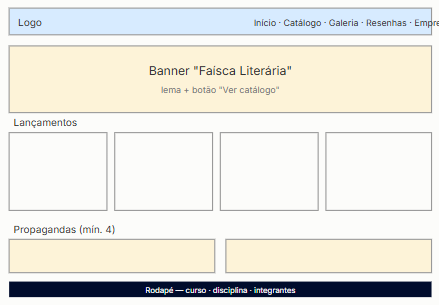
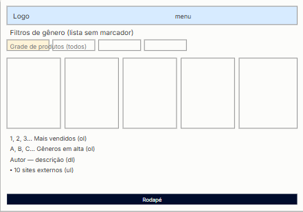
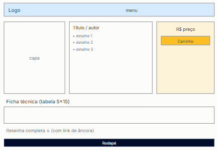
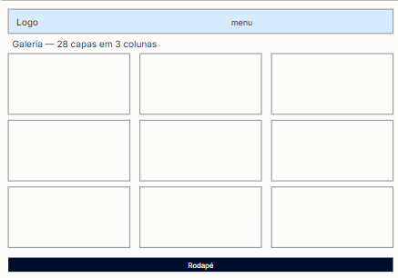
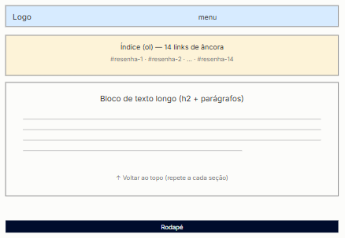
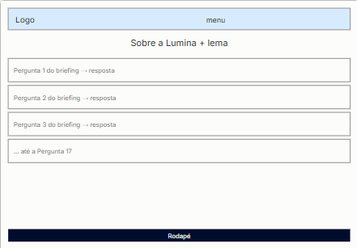

<div align="center">


# Lumina Livros

**Onde cada página acende uma ideia.**

E-commerce de livraria e papelaria, feito com HTML5, CSS3 e JavaScript puro.


</div>

---

## Sobre o projeto

A **Lumina** é uma livraria e papelaria fictícia, criada como Mini Projeto Front-End da disciplina de **Desenvolvimento Web** (Ciência da Computação, UniCEUB, Turma B).

O site foi construído **sem frameworks, bibliotecas externas ou back-end**: apenas HTML, CSS e JavaScript. Todo o catálogo vem de um único arquivo de dados (`js/produtos-dados.js`) e é renderizado dinamicamente pelo JavaScript, com filtros, rankings e páginas de produto geradas a partir da URL.

A identidade da marca segue o conceito **warm modern**: tradição acolhedora com visual moderno, tons quentes (creme, âmbar e dourado) sobre azul marinho profundo, com tipografia serifada nos títulos.

## Funcionalidades

- **Homepage** com banner, os 4 lançamentos mais recentes (ordenados por data de publicação), 4 propagandas de patrocinadores e logos das marcas parceiras.
- **Catálogo** com 31 produtos (25 livros e 6 itens de papelaria), filtro por gênero, ranking de mais vendidos, gêneros com mais títulos e autores em destaque, todos gerados via JavaScript.
- **Página de produto única** (`produto.html?id=N`) preenchida dinamicamente: capa, preço, descrição, ficha técnica em tabela 5×15 com `colspan`/`rowspan` e resenha completa. Os campos da tabela mudam conforme o produto seja livro ou papelaria.
- **Galeria** com 26 capas em grade de 3 colunas.
- **Resenhas** em texto longo, com índice por âncoras e link de retorno ao topo.
- **Página institucional** com o briefing completo da empresa (17 questões).
- **Central de documentação** com arquitetura de arquivos, wireframes, manual de marca, folder institucional e mapa dos requisitos atendidos.
- **Layout responsivo**, com ajustes para tablet e celular.

## Páginas

| Página | Arquivo | O que tem |
|---|---|---|
| Início | `homepage.html` | Banner, lançamentos, propagandas e parceiros |
| Catálogo | `catalogo.html` | Grade de produtos, filtros, rankings e 10 links externos |
| Produto | `paginas-produtos/produto.html` | Template único, carregado por `?id=` |
| Galeria | `galeria.html` | Capas dos livros em 3 colunas |
| Resenhas | `resenhas.html` | 26 resenhas com navegação por âncora |
| Empresa | `empresa.html` | Briefing da Lumina |
| Documentos | `documento.html` | Documentação técnica, wireframes e requisitos |

## Como executar

Não há dependências nem etapa de build.

**Opção 1: abrir direto no navegador**

```bash
git clone https://github.com/SEU-USUARIO/SEU-REPOSITORIO.git
cd SEU-REPOSITORIO
# abra o homepage.html com duplo clique
```

**Opção 2: servidor local (recomendado)**

```bash
# com Python
python -m http.server 8000
# ou com Node
npx serve .
```

Depois acesse `http://localhost:8000/homepage.html`. Também funciona com a extensão **Live Server** do VS Code.

## Estrutura do repositório

```
.
├── homepage.html
├── catalogo.html
├── galeria.html
├── resenhas.html
├── empresa.html
├── documento.html
├── paginas-produtos/
│   └── produto.html          # template único de produto
├── css/
│   └── main.css              # design tokens, layout e responsividade
├── js/
│   ├── produtos-dados.js     # base de dados dos 31 produtos
│   ├── homepage.js           # lançamentos
│   ├── catalogo.js           # grade, filtros e rankings
│   ├── produto.js            # página de produto via ?id=
│   └── main.js               # ponto de entrada comum
├── img/
│   ├── logo/                 # logotipo e ícone (SVG)
│   ├── banners/              # propagandas de patrocinadores
│   ├── editoras/             # logos de editoras e marcas
│   ├── galeria/              # capas da galeria
│   ├── produtos/             # imagens dos produtos
│   └── wireframes/           # wireframes das páginas
└── documentos/
    ├── DocumentoDePlanejamento.pdf
    └── Folder-Institucional-Lumina.pdf
```

## Como funcionam os dados

Cada produto é um objeto em `js/produtos-dados.js`. Para adicionar um item ao site, basta incluir um novo objeto no array `produtos`; catálogo, rankings e página de produto se atualizam sozinhos.

```js
{
  "id": 1,
  "titulo": "O Poderoso Chefão",
  "autor": "Mario Puzo",
  "genero": "Clássico/Crime",
  "preco": 96.39,
  "editora": "Record",
  "isbn": "6555870958",
  "paginas": 496,
  "publicacao": "2020-11-09",
  "imagem": "img/produtos/OPoderosoChefao.jpg",
  "descricaoCurta": "Clássico sobre a família Corleone...",
  "categoria": "Livro",            // "Livro" ou "Papelaria"
  "resenhaCompleta": "<p>...</p>"
}
```

A página de produto é acessada por `paginas-produtos/produto.html?id=1`. Se o `id` não existir, ela exibe "Produto não encontrado".

## Identidade visual

| Cor | Hex | Uso |
|---|---|---|
| Creme suave | `#FFF7E3` | Fundo das páginas |
| Azul marinho profundo | `#000C2C` | Texto |
| Âmbar | `#FBBF24` | Botões, bordas e destaques |
| Dourado queimado | `#D97706` | Hover e detalhes |

**Tipografia:** [Playfair Display](https://fonts.google.com/specimen/Playfair+Display) nos títulos e [Inter](https://fonts.google.com/specimen/Inter) no corpo do texto, carregadas pelo Google Fonts.

## Wireframes

Esboços de baixa fidelidade de cada página, em `img/wireframes/`.

| Homepage | Catálogo | Produto |
|---|---|---|
|  |  |  |

| Galeria | Resenhas | Empresa |
|---|---|---|
|  |  |  |

## Documentação

- [Documento de Planejamento (PDF)](documentos/DocumentoDePlanejamento.pdf)
- [Folder Institucional (PDF)](documentos/Folder-Institucional-Lumina.pdf)

## Limitações conhecidas

Por ser um projeto acadêmico exclusivamente front-end:

- O botão **Adicionar ao Carrinho** e o botão **Favoritar** só dão retorno visual; nada é salvo e não existe carrinho de compras real.
- Não há login, pagamento, estoque ou banco de dados.
- Os dados da empresa (filiais, contatos, verba) são fictícios, vindos do briefing da disciplina.

## Equipe

Ciência da Computação · Desenvolvimento Web · Turma B

- João Wíctor Gomes Rodrigues de Oliveira
- Leonardo Maneiro
- Nathan Henrique da Silva Carvalho

---

<div align="center">
Projeto acadêmico sem fins comerciais. Capas, marcas e logos pertencem aos seus respectivos detentores.
</div>
